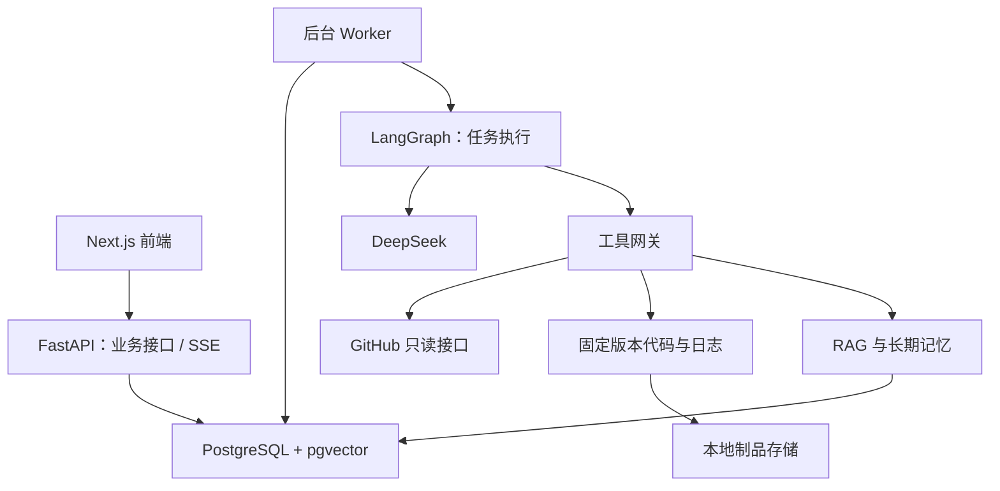

<!-- 文件用途：说明六周开发计划、各步产物和验收条件。 -->
# DevFlow 独立实现：六周核心版开发计划

## 一、目标与范围

按照已经确认的选择，本项目采用 **Python + FastAPI + LangGraph + Next.js + PostgreSQL/pgvector + DeepSeek API**，用于个人本地使用和求职演示。

六周后的完整使用流程是：

> 添加 GitHub 仓库 → 选择 PR 或失败的 CI → Agent 读取代码、日志和项目资料 → 展示带引用的分析报告 → 追问与补查 → 导出评论草稿 → 将核验过的经验保存为长期记忆。

**第一版必须交付：**

- 可交互前端：仓库、分析工作台、知识库、记忆和运行记录。
- PR 风险审查、GitHub Actions CI 排障、项目知识问答。
- RAG、上下文压缩、数据库持久化的长期记忆。
- 工具参数校验、调用预算、任务取消、checkpoint 和中断恢复。
- 证据引用、运行轨迹、成本统计、固定评测集。
- Markdown 报告和评论草稿导出。
- Docker Compose 部署与无需密钥的样例演示。

**后续版本再做：** Issue 自动分诊、周报、动态多 Agent 规划、MCP、通用 Skill Runtime、真实 GitHub 写操作、多用户权限、代码修改与测试执行沙箱。

因此，第一版不设置真实操作审批页面，也不申请 GitHub 写权限。长期记忆的审核仍保留，它只修改本地数据。

排期按每周约 **15–20 小时、六周共 90–120 小时**估算。第 4 周形成可演示版本，第 6 周完成工程验证；如果只有四周，交付第 4 周版本，明确标注尚未完成的能力。

## 二、固定架构与技术选择

### 服务结构

- **代码组织：** 一个仓库，前端和 Python 后端分开；API、worker 共用后端业务模块，以两个进程运行。
- **开发环境：** Python 3.11 系列最新补丁版、Node.js 24 LTS、npm、uv。当前检测到 Node 21，已结束支持，初始化时切换至 Node 24。[Node 官方发布状态](https://nodejs.org/en/about/previous-releases)
- **前端：** Next.js App Router、TypeScript、Tailwind CSS、TanStack Query；中文界面，桌面浏览器优先。
- **数据库：** PostgreSQL 17 + pgvector，SQLAlchemy 管理业务数据，Alembic 管理迁移。
- **任务执行：** 数据库任务表领取任务，默认一个 worker 同时执行一个分析任务；通过租约、心跳与执行版本防止重复领取后的旧进程提交结果。
- **模型：** 默认 `deepseek-flash`，关闭思考模式，使用 Tool Calling，模型名称可配置。当前官方文档支持该配置。[DeepSeek 模型说明](https://api-docs.deepseek.com/quick_start/pricing/) · [工具调用文档](https://api-docs.deepseek.com/guides/tool_calls/)
- **向量模型：** 本地 CPU 运行 `intfloat/multilingual-e5-small`，384 维向量，按模型要求加入查询与文档前缀。[模型说明](https://huggingface.co/intfloat/multilingual-e5-small)
- **检索：** pgvector 精确相似度检索 + PostgreSQL 全文检索 + RRF 融合；中文使用应用层分词。第一版不增加独立重排模型或向量数据库。
- **文件存储：** 文档、代码和日志保存在项目数据卷，数据库保存元数据与内容哈希；长期记忆持久化到数据库，跨会话、重启后仍有效。
- **访问边界：** 单用户、本地端口仅绑定 `127.0.0.1`；浏览器请求校验来源，凭据只保存在服务端。
- **工程规则：** 所有自行创建和编辑的文本文件使用 CRLF；依赖版本写入锁文件，密钥不进入仓库。

当前 `D:\DevFlow` 为空，尚未初始化 Git。Docker CLI 已安装，但 Linux 引擎无法连接，第一周先解决启动问题。

## 三、按顺序执行的 24 个任务

每一步完成后，都要留下：**可运行结果、对应验证、已知限制**。前端从第一周同步开发。

### 第 1 周：建立工程和演示数据

**第 1 步：准备环境与项目骨架**

要做：

- 初始化 Git、Python 项目和 Next.js 项目。
- 配置 CRLF、忽略文件、环境变量示例、格式检查和依赖锁文件。
- 启动 Docker Linux 引擎，准备 PostgreSQL/pgvector。
- 创建后端健康检查接口、前端基础布局和数据库迁移入口。
- 整理启动命令，避免依赖个人机器上的隐式配置。

验收：新终端按文档可以启动前端、后端和数据库；页面能显示后端与数据库连接状态。

**第 2 步：准备可控的演示案例**

要做：

- 创建一个小型 Python 示例工程，准备正常修改、权限检查缺失、空值处理错误等 PR 数据。
- 准备测试失败、依赖安装失败、配置缺失等 CI 日志。
- 编写几份设计说明和故障复盘资料，作为后续 RAG 数据。
- 每个案例标注预期问题、正确证据位置和不应得出的结论。
- 提供 fixture 数据源；真实模式和样例模式使用同一套业务接口，页面明确标识。

验收：无需 GitHub Token 和模型 Key，可以浏览样例仓库、PR 和 CI 数据。

**第 3 步：建立第一批数据模型**

要做：

- 建立仓库、会话、消息、运行任务、运行事件、证据和制品元数据。
- 实现迁移、样例数据导入与数据访问层。
- 每个任务保存仓库、输入版本、运行配置和唯一 ID。
- 定义失败原因和错误响应格式。

验收：任务和会话写入后，重启 API 仍能读取；重复导入样例不会重复创建同一条数据。

**第 4 步：完成前端主框架**

要做：

- 仓库列表和仓库详情页。
- 分析工作台：左侧会话，中间报告，右侧证据。
- 统一加载、空数据、错误和重试状态。
- 建立前后端类型契约，优先从 OpenAPI 生成前端接口类型。

验收：能从仓库列表进入 PR，创建一个样例分析任务，并打开任务详情。

**本周成果：一个真正连通数据库的全栈应用。**

---

### 第 2 周：接入 GitHub、任务与流式进度

**第 5 步：实现 GitHub 只读适配器**

要做：

- 支持输入仓库地址，校验并加入仓库列表。
- 读取 PR 详情、变更文件、关联 Issue、Actions 运行和 job。
- 处理分页、限流、无权限、资源不存在及日志过期。
- 记录获取时间；限制初始同步规模，第一版只加载最近 20 个 PR，按需获取详情。
- 使用只读、限定仓库范围的 GitHub Token。

验收：可以读取一个真实仓库；错误提示能区分无权限、限流和资源缺失。

**第 6 步：实现版本固定与证据存储**

要做：

- 分析开始时记录 PR 的 base/head SHA。
- 按指定提交读取所需文件，先覆盖 Python、JS/TS、配置文件和 Markdown。
- PR diff 缺失或截断时标记不完整，必要时补取对应版本文件。
- 日志保存原文、行号、job ID 与内容哈希。
- 建立证据 ID，让报告能引用文件行、日志行和文档片段。
- 不执行被分析仓库中的代码，不开放任意 shell 工具。

验收：PR 后续发生变化，也能回看旧报告所使用的证据版本。

**第 7 步：实现持久化后台任务**

要做：

- 创建任务后立即返回任务 ID，由 worker 执行。
- 使用数据库锁领取任务，保存租约和心跳。
- 支持任务排队、失败、取消和状态查询。
- 创建任务支持幂等键，防止重复点击产生多个任务。
- 使用模拟长任务验证，暂不依赖模型。

验收：关闭页面不影响后台任务；重复提交不会重复启动；取消后不再进入下一步骤。

**第 8 步：实现 SSE 和任务时间线**

要做：

- 先持久化事件，再向前端发送。
- 展示任务创建、开始、工具调用、阶段完成、错误和结束。
- 事件带递增序号，支持断线后从最后收到的位置继续。
- 前端按事件 ID 去重，刷新页面后恢复任务状态。
- 浏览器断开与用户主动取消使用不同逻辑。

验收：刷新、断网重连后，进度不重复、不遗漏；历史运行可以重新打开查看。

**本周成果：真实 GitHub 数据和可靠的任务执行通道。**

---

### 第 3 周：做通 PR 审查和 CI 排障

**第 9 步：封装 DeepSeek 模型入口**

要做：

- 统一模型配置、消息、工具定义、超时、调用记录和 usage 统计。
- 用最小案例验证工具调用和 JSON 输出。
- Pydantic 校验结构化结果；格式错误最多修正一次。
- 区分鉴权错误、限流、网络错误和输出格式错误。
- 保留可替换的假模型适配器，供自动化测试使用。

验收：真实模型完成一次“选择工具 → 接收工具结果 → 输出结构化答案”；无效 Key 不会无限重试。

**第 10 步：实现工具网关**

首批工具固定为：

- 获取 PR 详情和 diff。
- 读取指定提交的文件片段。
- 获取 CI 状态和日志片段。
- 查询关联 Issue。
- 检索项目知识——先保留接口，第 4 周接入实现。

统一执行：

- 参数 schema 校验、仓库范围校验和结果长度限制。
- 超时、只读请求重试、调用日志和错误序列化。
- 相同参数重复调用检测。
- 大结果只返回摘要和制品指针，需要时分页读取。

验收：非法路径、未登记仓库、未知工具及超长结果都得到明确处理。

**第 11 步：实现 LangGraph 执行循环与 PR 审查**

要做：

- 建立“组装上下文 → 模型决策 → 工具执行 → 继续/结束”的图。
- 在图外维护业务状态和预算，避免把所有约束交给提示词。
- PR 报告固定包含：摘要、风险项、严重程度、证据、建议、未确认事项及检查范围。
- 逐条校验证据 ID 和行号；不存在的引用不能进入最终报告。
- 保存提示词、模型配置和代码版本，便于后续复现。

验收：已知缺陷的样例 PR 能输出可定位的风险；没有证据时能够说明不足。

**第 12 步：实现 CI 排障与报告交互**

要做：

- 从 job 日志中提取错误块及前后文，保留全文指针。
- 输出失败阶段、根因假设、证据、验证步骤和修复建议。
- 支持 `pr_review` 与 `ci_debug` 两种任务入口。
- 前端完成风险卡片、日志引用展开、停止按钮和 Markdown 导出。
- PR 分析可查询 CI 证据，但第一版不做动态多 Agent 调度。

验收：至少跑通一个真实 PR 分析和一个真实失败 CI 分析；生成内容明确标记为分析建议。

**本周成果：能够处理真实任务的 Agent。**

---

### 第 4 周：加入 RAG，形成可演示版本

**第 13 步：实现文档导入与版本管理**

要做：

- 支持 Markdown、TXT 和可提取文本的 PDF；扫描 PDF/OCR 留到后续。
- 文档限定所属仓库，限制单文件大小，记录解析状态和失败原因。
- 按内容哈希去重，保留版本和来源。
- 按标题、段落切分；以向量模型 tokenizer 控制块长，默认 384 token、重叠 48 token。
- 支持删除文档及关联索引。

验收：重复上传不产生重复有效文档；更新和删除后检索只使用有效版本。

**第 14 步：实现本地向量化与混合检索**

要做：

- 下载并固定本地向量模型版本，CPU 推理，缓存重复内容的向量。
- 使用 `query:` 和 `passage:` 前缀，归一化向量。
- 对文档与查询采用相同的中文分词和英文标识符处理规则。
- 向量、关键词分别召回前 20 条，使用 RRF 融合，默认返回最多 6 条。
- 检索前限定仓库和有效文档版本。
- 增加检索调试视图，显示来源、排序和片段。

验收：中文问题能够找到相关中英文资料；A 仓库资料不会出现在 B 仓库结果中。

**第 15 步：把知识检索接入 Agent**

要做：

- 将知识检索注册为工具。
- 增加 `knowledge_qa` 任务类型。
- PR 和 CI 分析按需查询设计约束和历史复盘。
- 保持数据职责清楚：当前状态查 GitHub，代码查固定提交，历史资料走 RAG。
- 找不到依据时返回证据不足，不编造引用。

验收：同一问题可展示“直接分析”与“加入项目资料”的结果差异，引用可点击核查。

**第 16 步：完成第一个可交付演示版**

要做：

- 串联仓库 → PR/CI → 分析 → 证据 → 草稿导出。
- 补齐知识库上传、索引状态和来源预览页面。
- 提供真实模式与 fixture 模式切换说明。
- 完成一段 3 分钟演示流程。
- 修复影响主流程的错误，暂停扩展新功能。

验收：按固定脚本能完成一次端到端演示，任何样例数据都有明确标识。

**本周成果：可展示的 v0.1；尚不宣称具备完整长期记忆和恢复验证。**

---

### 第 5 周：上下文、长期记忆和恢复

**第 17 步：实现上下文预算与压缩**

要做：

- 分离系统指令、当前请求、近期消息、摘要、工具结果和检索证据。
- 默认单次输入预算 12,000 token、输出上限 2,000 token。
- 按顺序处理超限：去重 → 裁剪低相关证据 → 压缩旧工具结果 → 摘要旧对话。
- 保留来源 ID、尚未解决的问题及工具调用与结果的配对关系。
- 保存原始材料，允许用户查看压缩前内容。
- 记录估算 token 与实际 usage 的偏差。

验收：长对话能继续运行，关键约束仍保留，压缩效果能够量化。

**第 18 步：实现可审核的长期记忆**

要做：

- 用户从报告中选择“提取经验”，由模型提出候选记忆。
- 保存摘要、来源、仓库、适用版本、有效期和审核状态。
- 用户编辑、批准后才参与后续召回。
- 支持撤销、过期和用新条目替代旧条目。
- 默认有效期 30 天；涉及具体代码版本的经验，版本不匹配时不自动注入。
- 新会话组装上下文时重新检查记忆状态。

验收：批准的经验能在新会话中召回；未批准、过期和撤销条目不能召回；重启服务后记忆仍存在。

**第 19 步：接入 checkpoint 并验证恢复**

要做：

- 使用 PostgreSQL checkpointer，每个 run 使用独立图执行标识；会话历史由业务层管理。
- checkpoint 保存图状态，业务表保存任务状态、租约和事件。
- 恢复时复用原任务证据快照，校验制品是否仍存在。
- 读取工具结果可复用；未完成步骤允许重试，但不能重复写入业务事件和结果。
- worker 重启后恢复过期租约任务，自动恢复最多一次；仍失败则进入待处理状态。
- 记录恢复次数和额外模型开销，不承诺模型调用只发生一次。

LangGraph 的持久化能保存执行状态，但业务幂等与恢复边界仍需自行实现。[LangGraph 持久化文档](https://docs.langchain.com/oss/python/langgraph/persistence)

验收：在工具完成后、模型调用中及报告保存前分别终止 worker，重启后得到可解释的恢复结果。

**第 20 步：补齐安全边界和草稿体验**

要做：

- 文档、Issue、注释和日志统一视为不可信输入。
- 工具白名单、仓库限制在服务端校验。
- 脱敏已知密钥与令牌格式；前端 Markdown 禁止执行原始 HTML。
- 草稿支持本地编辑、复制和下载，显示所依据的提交版本。
- 报告重新打开时可检查 PR 是否变化，并标记旧结论。
- 不注册 GitHub 写工具；测试模型试图发评论时系统无法执行。

验收：恶意资料无法改变工具权限；草稿操作不向 GitHub 发出写请求。

**本周成果：具有可追溯记忆、预算限制和恢复能力的版本。**

---

### 第 6 周：评测、部署和求职材料

**第 21 步：建立固定评测集**

要做：

- 扩展到 30 个案例：PR、CI、知识问答各 10 个。
- 每题标注预期问题、证据和允许的“无法确定”情况。
- 按案例来源分成 20 个开发案例、10 个留出案例，避免同一案例轻微改写后分到两组。
- 单独建立确定性工程测试：权限、取消、重连、恢复、文档删除和记忆撤销。
- 保存模型、提示词、检索配置、代码提交和数据集版本。

验收：同一命令可以执行指定评测集，生成逐题结果和失败原因。

**第 22 步：完成两组对照实验**

要做：

- 对照一：关键词检索与混合检索。
- 对照二：未压缩上下文与预算压缩。
- 统计 Recall@6、引用正确性、PR 误报/漏报、CI 根因定位、耗时、token 和费用。
- 语义结论采用人工核查，模型评分仅作辅助。
- 展示失败案例；如果混合检索或压缩没有带来改善，如实记录。

验收：得到有样本数、配置和失败案例的评测报告，不能只展示成功截图。

**第 23 步：完成部署与故障检查**

要做：

- Compose 包含前端、API、worker 和数据库，配置持久化数据卷及健康检查。
- 提供样例数据初始化、模型权重预下载和真实模式配置说明。
- 在干净环境验证安装、迁移、启动、重启及数据恢复。
- CI 默认跑假模型、fixture 和数据库集成测试，不消耗真实 API 额度。
- 实际模型测试通过显式命令触发。
- 增加启动时的配置检查与清晰错误提示。

验收：按 README 可启动；不配置密钥仍能运行样例模式；服务重启不丢文档、报告和记忆。

**第 24 步：整理可核验的求职材料**

要做：

- README：场景、架构、启动、演示、限制。
- 架构决策：为什么 pgvector、为什么业务状态与 checkpoint 分开、为什么按版本引用代码。
- 评测报告：真实结果和不足。
- 故障实验：恢复、取消、SSE 重连和记忆失效。
- 3 分钟录屏及简历项目描述。
- 简历只列已实现和实测的能力，不写真实写操作、动态多 Agent 或多用户功能。

验收：面试时可以从功能演示进入实现细节，再拿测试和评测结果支撑说明。

## 四、接口与运行约束

### 最小接口范围

所有业务接口使用 `/api/v1` 前缀。

| 接口组 | 必须支持的行为 |
|---|---|
| 仓库 | 添加、列表、详情、刷新、PR/CI 列表 |
| 会话 | 新建、列表、读取消息、提交追问 |
| 任务 | 创建、查询、取消、手动重试、SSE 事件、证据读取 |
| 文档 | 上传、查询索引状态、预览、更新、删除 |
| 记忆 | 提取候选、列表、编辑、批准、撤销 |
| 草稿 | 读取、编辑、复制或下载；无发布接口 |
| 评测 | 运行评测集、查看结果、对比配置 |

关键类型固定为：

- `Run`：任务类型、仓库、会话、输入版本、状态、预算、配置版本。
- `EvidenceRef`：来源类型、资源 ID、提交或文档版本、位置、获取时间、内容哈希。
- `AnalysisReport`：摘要、发现、证据引用、建议、未确认事项、检查范围。
- `ToolResult`：成功/失败、数据或制品引用、是否截断、错误类型、是否允许重试。
- `Memory`：摘要、来源、适用范围、有效期和审核状态。

任务状态采用：

`queued → running → succeeded / failed / cancelled / needs_attention`

### 默认运行限制

以下均为应用默认值，可通过配置调整：

- 单任务最多 6 次模型调用、12 次工具调用、累计 60,000 token、10 分钟。
- 同一工具及参数连续重复 3 次时停止，并说明缺少进展。
- GitHub 读取超时 30 秒，模型请求超时 90 秒。
- 只读请求遇网络错误或限流最多重试 2 次；鉴权和参数错误不重试。
- checkpoint、事件、模型 usage 和成本从早期任务闭环开始记录。
- 沿用 100 元以内 API 预算目标；根据 usage 和配置价格估算，70 元提醒，90 元停止新模型请求并留出余量，最终费用以服务商账单为准。
- 历史回放只读取保存的数据；重新运行创建新 run，不混淆两者。

## 五、最终验收与开发节奏

**第一版完成，需要同时满足：**

1. **真实链路：** 真实 GitHub 数据和 DeepSeek 均已接通，样例模式标识清楚。
2. **结果可查：** 报告引用能定位到实际文件、日志或文档，标明版本和检查范围。
3. **运行可控：** 达到调用、token 或时间限制时会停止；取消后不启动新步骤。
4. **知识可维护：** 文档更新、删除及记忆批准、撤销会改变后续检索结果。
5. **故障可解释：** 刷新不丢进度，worker 重启有恢复结果，无法恢复时给出原因。
6. **外部只读：** 系统不修改仓库、不发布评论、不合并 PR。
7. **效果有证据：** 固定评测报告、两组对照实验和失败案例齐全。
8. **环境可复现：** README 和 Compose 能在干净环境完成部署。

日常开发以一个编号任务为单位：先确认验收条件，再实现、验证，最后记录取舍和限制。出现延期时，先简化视觉效果和非关键交互；保留证据引用、状态持久化、预算限制及关键故障测试。

**第一个实际开发任务是第 1 步：准备环境与工程骨架；完成其启动验收后，再进入数据和业务实现。**
