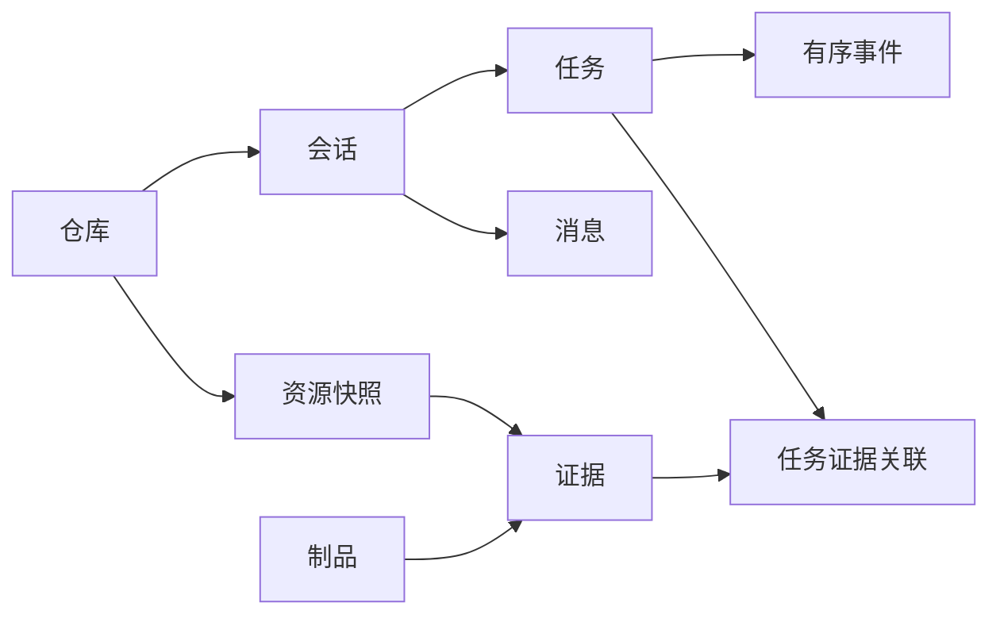

<!-- 文件用途：记录数据持久化、迁移、幂等及重启验证。 -->
# 第 3 步：业务数据持久化验收

日期：2026-10-28（Asia/Shanghai）

状态：第 3 步实现完成；第 2 步样例已随本步回归检查。前端仍为只读浏览，分析工作台在第 4 步接入。

## 已建立的数据模型

共 9 张业务表，迁移版本为 0002_business_models：

| 表 | 职责 |
| --- | --- |
| repositories | 仓库来源、名称、默认分支与提交版本 |
| repository_resources | PR、CI、文档的不可变 JSONB 快照及当前版本指针 |
| conversations | 绑定仓库的会话与下一个消息序号 |
| messages | 有序消息；用户入口只能写 user 角色 |
| runs | 任务唯一 ID、输入版本、运行配置、状态、幂等键及失败字段 |
| run_events | 任务内递增的持久化事件 |
| artifacts | 本地制品路径、实际字节 SHA256、大小及媒体类型 |
| evidence | 来源类型、版本、文件或日志位置、行范围及制品引用 |
| run_evidence | 创建任务时固定的证据集合，并约束仓库归属 |



这些关系由外键、复合外键、唯一索引和检查约束共同保证，不能仅依赖接口层校验。

## 迁移与导入

```powershell
. .\scripts\env.ps1
uv run --locked alembic upgrade head
uv run --locked python -m devflow.import_fixtures
uv run --locked alembic check
```

setup.ps1 已包含迁移和样例导入。

新数据库首次导入创建：1 个仓库、10 个资源快照、14 个制品、16 条证据。重复导入的上述新增数均为 0。导入使用事务级 advisory lock，多个进程不会同时切换同一资源的当前版本。

导入前校验资源归属、文件和日志哈希、CI 所属 PR 版本、文档版本和行数。不一致的输入在写入之前被拒绝。资源变更生成新快照，旧快照和旧证据保留；同内容制品复用。

源码、配置和文档新增注释后，演示提交和行号已重建。历史任务仍指向旧版本。因为保留历史，当前本地库的总快照或制品数可以大于首次导入数量；幂等验证依据是相同数据再次导入时新增数为 0。

## 数据访问模式

默认配置：

```dotenv
DATA_SOURCE=fixture
FIXTURE_STORAGE=database
```

仓库、PR、CI 和资料接口默认读取数据库，不会在数据库错误时自动返回文件样例。

显式设置 FIXTURE_STORAGE=files 可保留无数据库的只读样例浏览；任务创建要求数据库模式。GitHub 适配器仍在第 5 步实现。runtime 会返回当前存储模式，页面标明「样例数据 · 数据库」或「样例数据 · 文件」。

## 持久化业务接口

```text
POST /api/v1/conversations
GET  /api/v1/conversations?repo_id=...
GET  /api/v1/conversations/{id}
POST /api/v1/conversations/{id}/messages
GET  /api/v1/conversations/{id}/messages
POST /api/v1/runs
GET  /api/v1/runs?repo_id=...
GET  /api/v1/runs/{id}
GET  /api/v1/runs/{id}/events
GET  /api/v1/runs/{id}/evidence
GET  /api/v1/runs/{id}/artifacts
GET  /api/v1/artifacts/{id}?repo_id=...
```

创建任务时原子保存用户消息、任务、固定版本的证据关联和 run.queued 事件，任何一步失败都回滚。

任务包含 repository ID、conversation ID、message ID、task UUID、PR/CI HEAD 或文档版本、资源快照 ID、完整无密钥配置及其哈希。配置中明确记录 executor=not_implemented，不把记录创建误报为分析执行完成。

POST /runs 可带 Idempotency-Key：首次返回 201，相同有效参数重放返回原任务和 200，不再添加消息或事件；不同参数复用同一键返回 409。当前为单用户本地作用域。

消息与事件分别通过锁定会话行和任务行分配序号。会话、消息和任务列表支持分页；事件可按 after 续读 JSON，SSE 在第 8 步实现。

## 制品与版本边界

导入时把原文复制到 data/artifacts 的内容地址文件，再保存数据库元数据。文本文件使用 CRLF；制品 sha256 覆盖实际存储字节，与样例 JSON 中按 LF 规范化的 content_sha256 含义不同。

读取制品前校验路径范围和内容哈希。文件缺失或被改写返回明确错误；重复导入可修复制品缺失，并复用原记录 ID。

数据库回滚不会删除已写入的内容地址文件，可能留下未引用文件；垃圾回收不属于本步。用户数据位于 PostgreSQL 数据卷和 data/artifacts，两部分均需保留。

## 失败原因与错误格式

错误统一为：

```json
{
  "detail": {
    "code": "target_not_found",
    "message": "任务目标或资料未导入",
    "request_id": "..."
  }
}
```

参数错误附加经过脱敏的 issues，不回显原始输入。响应带相同 X-Request-ID。已定义未找到、仓库不匹配、幂等冲突、制品缺失或损坏、来源拒绝及数据库不可用等错误。

任务结构预留 model_error、tool_error、budget_exceeded、timeout、input_changed、artifact_missing、worker_lost、internal_error。实际执行器与状态流转将在后续步骤实现。

新增写接口会检查浏览器 Origin；CLI 可在没有 Origin 的情况下调用。第一版仍为仅绑定本机端口的个人应用，没有增加多用户鉴权。

## 实际重启验收

在真实 API 上创建：

- 会话：2d4c74aa-6520-4da5-914f-b7216e87f14a
- 任务：9d9ff7df-6955-4297-b32f-262b06008712

验收记录保存在被 Git 忽略的 data/step-03-proof.json，不含密钥。

先更新样例版本，再停止旧 API 进程并启动新进程。重新读取会话、消息、任务、初始事件、原输入版本、证据及制品，逐项比较全部一致。原任务 HEAD 与当前 PR HEAD 已不同，证明读取旧任务时没有切换到最新版本。

复验命令：

```powershell
uv run --locked python -m devflow.persistence_smoke create
# 重启 API 后
uv run --locked python -m devflow.persistence_smoke verify
```

create 在验收记录已存在时仅验证，不重复创建；这些任务不会在本步骤调用模型。

## 测试与注释

完整检查结果：42 项后端测试通过，5 项演示工程测试通过；Ruff、ESLint、TypeScript、Prettier 和生产构建均通过，Windows PowerShell 初始化脚本重复执行成功。真实数据库测试使用自动创建的 devflow_test_* 临时数据库，不回滚或清理用户业务库；覆盖新库迁移、回滚再升级、幂等、事务、并发序号、跨仓库约束及输入版本固定。

每个源码和可注释配置文件已补充一句用途说明，事务、哈希校验、幂等及代理边界处增加实现注释。Markdown 也有用途注释。JSON、版本 pin、锁文件、diff 和日志保留原格式，其职责见 [项目文件用途索引](file-guide.md)。Alembic ini 使用 ASCII 注释，兼容 Windows 系统编码读取。

下一步：第 4 步，接入分析工作台和任务详情交互；后台 worker、SSE 和 Agent 执行仍按后续计划推进。
